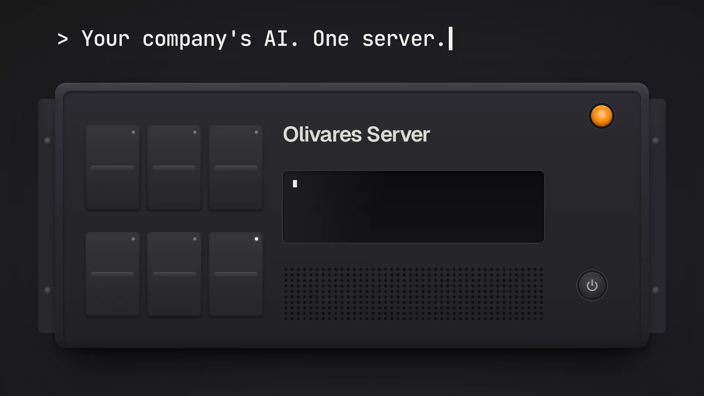

<!-- SPDX-FileCopyrightText: 2026 Olivares.AI -->
<!-- SPDX-License-Identifier: AGPL-3.0-only -->

**Languages:** **English** · [Español](./README.es.md) · [简体中文](./README.zh.md) · [Русский](./README.ru.md) · [日本語](./README.ja.md) · [Deutsch](./README.de.md) · [Français](./README.fr.md) · [Українська](./README.uk.md) · [한국어](./README.ko.md) · [Português](./README.pt.md)

# Olivares Server

<a href="https://olivares.ai/server"></a>

Olivares Server is the Olivares AI™ appliance: a Linux image that installs the Olivares engine and console, a local
console for the host itself, and the first-boot setup that starts the product.

This repository holds the **recipe** for the Community appliance: the sources, image definitions, service units,
SELinux policy and tests from which the image is built.

## What is here

| Path | Contents |
| --- | --- |
| `appliance/answers/` | The offline answers tool. It validates one answers document and prints a plan. |
| `appliance/cmd/`, `appliance/layer/` | First boot, the Appliance Console (`:9443`), the repair console and the root helpers it uses. |
| `appliance/images/` | The image recipe (KIWI), the ISO, qcow2 and OVA assembly, and the pinned build toolchain. |
| `appliance/selinux/` | The SELinux policy module and the tools that generate and check it. |
| `appliance/test/` | The boot battery and the recipe tests. |
| `packaging/nfpm/`, `scripts/` | The two package definitions and the script that builds the Appliance Console payload. |

`appliance/README.md` documents the answers document, first boot and the console in detail.

## Build and test

The recipe is written against the product source in [olivaresai/olivares](https://github.com/olivaresai/olivares): its
Go code imports packages from that repository's `core/`. Copy this repository's top-level directories into a checkout
of that repository at the same paths, then run the module's tests from `appliance/`, which carries its own Go
workspace for this purpose:

```sh
git clone https://github.com/olivaresai/olivares-server
git clone --branch "$(cat olivares-server/RELEASE-VERSION)" https://github.com/olivaresai/olivares
cp -r olivares-server/appliance olivares-server/packaging olivares-server/scripts olivares/
cd olivares/appliance && go test ./...
```

Some recipe tests read the release workflows of the build that publishes the images. Those workflows and their
publication helpers are maintained with the licensed distribution, so those tests skip here and run in that build.

Building an image needs a KVM-capable host and the toolchain pinned in `appliance/images/toolchain/`. Follow
`appliance/images/toolchain/README.md`.

## Editions

The image this recipe builds is the Community edition. The licensing service, the Business and Enterprise
capabilities and the packages they use are separate, licensed products and are not part of this repository. With a
Business licence installed, the image's `olivares-entitled-repo` helper lets the package manager fetch those packages
from the channel the licence entitles, and `olivares-edition.service` swaps the Community package for the Business one
on the running appliance, keeping its data. Removing the licence swaps it back. No image contains a Business package.

## How this repository is made

This repository is generated from the Olivares development source at each release. Do not open pull requests here:
a change made here is removed by the next release. Report problems and propose changes in
[olivaresai/olivares](https://github.com/olivaresai/olivares/issues).

## License

AGPL-3.0-only. See `LICENSE`, `DISCLAIMER.md` and `NOTICE`. To report a vulnerability, follow `SECURITY.md`.
